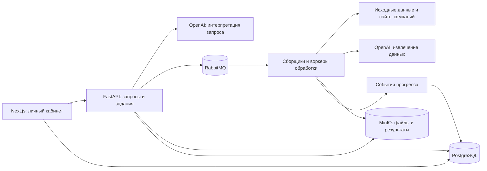

# Veles Scan

Veles Scan — сервис поиска организаций и сбора контактных данных для бизнеса. Пользователь описывает нужную выборку обычным текстом, проверяет условия поиска и получает Excel с данными компаний.

Проект объединяет сбор исходных сведений об организациях, обход их сайтов, обогащение через ИИ и обработку результатов в одном веб-сервисе.

Код опубликован для ознакомления и оценки проекта. Использование, изменение и распространение требуют письменного разрешения правообладателя, кроме случаев, предусмотренных [лицензией](LICENSE).

## Задача и результат

Сервис автоматизирует подготовку баз организаций: от выбора отрасли и условий поиска до сбора контактов и формирования итоговой таблицы. Реализован полный цикл обработки с личным кабинетом, фоновыми заданиями, отслеживанием прогресса и скачиванием результата.

## Как используется ИИ

- Преобразует запрос на обычном языке в коды ОКВЭД и фильтры по доступным данным организаций.
- Определяет, какие поля включить в итоговую выгрузку.
- Извлекает из текста сайтов описания компаний, общие контакты и контакты сотрудников.
- Собирает опубликованные на сайтах сведения о клиентах и партнёрах.

Ответы модели преобразуются в структурированные данные. После обогащения результаты объединяются с исходными сведениями, контакты нормализуются и очищаются от дублей.

## Возможности

- Регистрация, авторизация и управление проектами.
- Предварительный просмотр условий поиска и оценка стоимости.
- Фоновый сбор и обработка данных через очереди задач.
- Отслеживание прогресса, статусов и отмена задания.
- Выгрузка результата в Excel с выбранными полями.
- Баланс пользователя и интеграция пополнения через Т-Банк.
- Административный интерфейс, журналы обработки и состояние воркеров.
- Плановое обновление исходных данных организаций.

## Стек

| Часть | Технологии |
| --- | --- |
| Backend и обработка | Python, FastAPI, OpenAI API, SeleniumBase, BeautifulSoup, pandas, openpyxl |
| Интерфейс | Next.js, React, TypeScript, Tailwind CSS |
| Данные и очереди | PostgreSQL, RabbitMQ, MinIO/S3 |
| Запуск и мониторинг | Docker Compose, Prometheus-метрики, масштабирование фоновых воркеров |

## Архитектура



Основной пайплайн включает сбор данных организаций, подготовку списка сайтов, обогащение через OpenAI, объединение результатов, удаление дублей и формирование Excel. Планировщик отдельно запускает обновление исходных данных. Воркеры обработки масштабируются с учётом очереди и доступных ресурсов хоста.

## Структура репозитория

- `veles-scan-back/` — API, сборщики, этапы обработки и фоновые воркеры.
- `veles-scan-ui/` — интерфейс, авторизация, проекты, финансы и платежи.
- `infra/` — инициализация баз данных.
- `docker-compose.unified.yml` — общий контейнерный стек.
- `start.sh` — запуск и управление сервисами.
- `autoscale-workers.sh` — масштабирование воркеров обработки.

## Локальный запуск

Инструкции предназначены для правообладателя и лиц, получивших письменное разрешение на использование сервиса.

Требуются Docker с Compose и Bash. Для скриптов запуска и масштабирования используйте Linux или WSL.

Из корня репозитория:

```bash
cp .env.example .env
cp veles-scan-back/checko_runtime_config.example.py veles-scan-back/checko_runtime_config.py
```

Настройте `OPENAI_API_KEY` и остальные переменные в `.env`. В `veles-scan-back/checko_runtime_config.py` укажите нужные `TARGET_OKVED_CODES`, а также параметры прокси и user-agent для сборщика.

Запустите стек:

```bash
./start.sh
```

Интерфейс доступен на `http://localhost:3000`.

Команды управления:

```bash
./start.sh --status
./start.sh --logs
./start.sh --down
```

Платёжная интеграция настраивается отдельно через `TBANK_TERMINAL_KEY`, `TBANK_PASSWORD` и при необходимости `TBANK_NOTIFICATION_URL`. Для внешнего адреса приложения задайте `APP_PUBLIC_URL`. Подробности — в [README интерфейса](veles-scan-ui/README.md).

Локальные ключи, учётные данные, рабочие файлы и журналы обработки не входят в репозиторий. Примеры конфигурации находятся в `.env.example` и `veles-scan-back/checko_runtime_config.example.py`.

Подробнее об API, очередях и этапах обработки — в [README backend](veles-scan-back/README.md).

## Лицензия

Copyright (c) 2026 Maxim Shevarev. Все права защищены.

Проект распространяется на условиях собственной проприетарной [лицензии](LICENSE). Разрешено изучение исходного кода для оценки проекта и работы автора. Запуск, повторное использование, изменение, создание производных продуктов, распространение и коммерческое применение требуют предварительного письменного разрешения правообладателя.

Исключения для функциональности GitHub и применимого законодательства указаны в лицензии. Условия сторонних компонентов и отдельные уведомления об авторских правах сохраняются.
