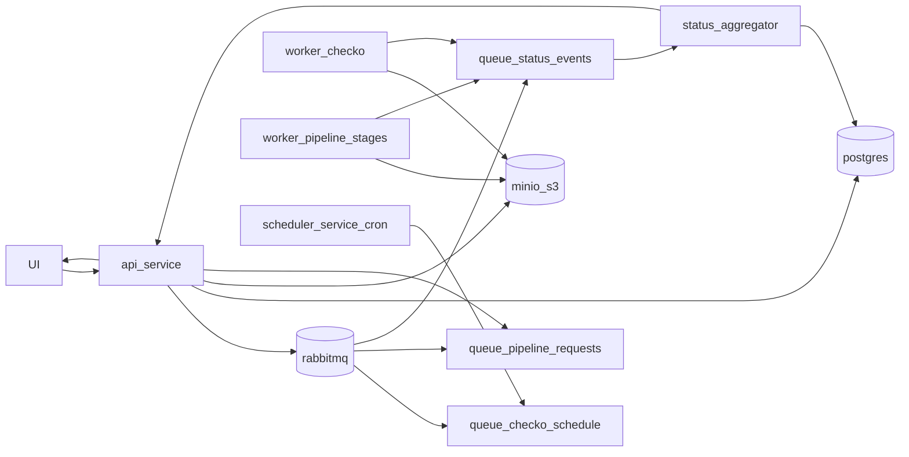

# Unified Container Pipeline

Полностью автономный pipeline в контейнерах:
- RabbitMQ для очередей задач и статусов,
- Postgres для состояния job и истории событий,
- MinIO (S3) для входных/выходных файлов,
- отдельные воркеры для `checko` и `stage_02..stage_08`,
- scheduler для периодического `checko_refresh`,
- API для UI (`submit/status/result`).
- `pipeline_worker` масштабируется host-side autoscaler'ом, `checko_worker` всегда работает в одном экземпляре.

## Схема архитектуры



## Структура

- `services/api/` - FastAPI сервис.
- `services/workers/` - `pipeline_worker`, `checko_worker`, `status_aggregator`.
- `services/scheduler/` - cron publisher для Checko refresh.
- `services/shared/` - настройки, RabbitMQ, S3, DB, модели, метрики.
- `docker/` - compose, Dockerfiles, RabbitMQ definitions, init SQL.
- `stage_*.py` - вычислительные этапы пайплайна.

## Очереди

- `jobs.pipeline.run` - запуск обработки по запросу UI.
- `jobs.checko.refresh` - запуск планового/ручного refresh checko.
- `jobs.status.events` - поток статусов прогресса.
- Для каждой очереди настроен DLQ через `jobs.dlx`.

## API

- `POST /jobs/upload-input` - загрузка входного файла в MinIO.
- `POST /jobs` - создать job и отправить в очередь.
- `GET /jobs/{job_id}` - получить текущее состояние.
- `GET /jobs/{job_id}/result` - получить presigned URL результата.
- `GET /health` - проверка живости.
- `GET /metrics` - Prometheus метрики API.

## Запуск в Docker (унифицированный стек)

Из каталога backend перейдите в корень репозитория, создайте локальные конфигурации и заполните их:

```bash
cd ..
cp .env.example .env
cp veles-scan-back/checko_runtime_config.example.py veles-scan-back/checko_runtime_config.py
```

Укажите `OPENAI_API_KEY` в `.env`, нужные `TARGET_OKVED_CODES`, параметры прокси и user-agent в `veles-scan-back/checko_runtime_config.py`. Затем запустите стек:

```bash
./start.sh
```

Сервисы поднимаются единым compose-файлом `docker-compose.unified.yml`.
UI доступен на `http://localhost:3000`. Сервисы взаимодействуют через внутреннюю Docker-сеть; опубликованные порты API, RabbitMQ, MinIO и PostgreSQL привязаны к `127.0.0.1`.

## Конфигурация

- `../.env` - единый env для всего стека (`OPENAI_API_KEY`, DB, RabbitMQ, MinIO).
- `checko_runtime_config.py` - целевые ОКВЭД, прокси и user-agent для stage_01; создаётся из `checko_runtime_config.example.py`.
- autoscaling настраивается через `AUTOSCALE_PIPELINE_*` и учитывает не только глубину очереди `jobs.pipeline.run`, но и доступные CPU/RAM хоста.

## Локальный запуск stages (без контейнеров)

```bash
python run_company_pipeline.py
```

или по отдельности:

```bash
python stage_01_collect_from_checko.py
python stage_02_prepare_active_sites_input.py
python stage_03_enrich_sites_with_openai.py
python stage_04_deduplicate_openai_json.py
python stage_05_merge_openai_into_excel.py
python stage_06_deduplicate_contacts.py
python stage_07_normalize_employee_names.py
python stage_08_add_clients_and_partners_sheets.py
```

## Smoke test

```bash
python tests/e2e_smoke.py
```

По умолчанию проверяет `/health`, затем пробует `upload + submit` если найден `tests/fixtures/sample_input.xlsx`.
